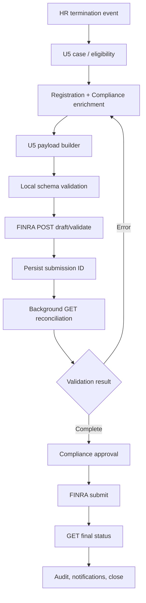

# FINRA Form U5 — Functional and Technical Integration Guide

**Version:** 1.0 | **Date:** 2026-10-23 | **Audience:** Firm registration/compliance, HR, engineering, QA, operations  
**Scope:** FINRA member firm, existing QA credentials, Python REST integration.  
**Status:** Implementation blueprint. **Do not submit production filings using illustrative values.** Validate exact schema and endpoint permissions against the live FINRA API Explorer and your firm's QA tenant.

## 1. Executive summary

Build a controlled Form U5 workflow triggered by a termination/registration-change event. HR supplies facts; Registration/Compliance determines filing scope and disclosures; an authorized approver releases the filing; Python integrates with FINRA's Submission API; a background worker reconciles the asynchronous outcome. Never treat an HR exit or HTTP 2xx response as evidence of a completed regulatory filing.

### Verified source references

1. FINRA Submission API: https://developer.finra.org/products/submission-api
2. FINRA Developer documentation and U5 section: https://developer.finra.org/docs#submission_api-registration-u5
3. FINRA authentication: https://developer.finra.org/node/1146
4. FINRA validate behavior: https://developer.finra.org/news/validate-feature-submission-api
5. FINRA Form U5 instructions (PDF): https://www.finra.org/sites/default/files/Form_U5_091115.pdf
6. FINRA August 18, 2026 schema-field validation change: https://developer.finra.org/release-notes/api-platform-august-18-2026-release-notes
7. FINRA regulatory obligations: https://www.finra.org/sites/default/files/2025-08/regulatory-notice-25-09.pdf

**Evidence caveat:** Public FINRA material verifies API base URLs, OAuth client-credential approach, U5 submission support, draft/validate behavior, and the regulatory form categories. Endpoint paths and example nested JSON below are drawn from the publicly documented Submission API/U5 examples discussed in this guide, but their current tenant-specific operation permissions, required fields, enumerations, and complete JSON schema must be checked in FINRA API Explorer before deployment. No live API calls were made with firm credentials.

## 2. Functional specification

### 2.1 Filing types

| Filing | Trigger | Information | Outcome |
|---|---|---|---|
| Full U5 | Registered individual leaves firm; all applicable registrations at filing firm end | Termination date, reason, explanation when applicable, disclosure questions, signatory | Termination of all firm SRO/jurisdiction registrations |
| Partial U5 | Some SRO/state registrations end while others remain | Selected registration category/regulator, authorized signatory | Selected registrations terminate |
| Amendment U5 | Previously filed U5 requires correction or newly known reportable information | Corrected fields, appropriate disclosure reporting pages, reason for change when required | Amended filing |
| Draft | Registration team preparing U5 | Partial working filing | Not submitted |
| Validate | Check completeness before final submission | U5 filingStatus `validate` | Draft plus completeness check; inspect GET result |
| Submit | Approved regulatory filing | Completed U5 and signatory | Asynchronous submission and final result |

**Important:** FINRA's Form U5 instructions say partial U5 does not include reason-for-termination or disclosure questions in the same way as full U5. An amendment is not the same as a new full termination. A full termination must be filed no later than 30 calendar days after the person leaves employment, according to the form instructions; FINRA's bylaws require initial U5 within 30 calendar days of registration termination and amendment within 30 calendar days of learning of facts necessitating amendment. Compliance must resolve the correct start date and any applicable rules for each case.

### 2.2 Functional business rules

- **BR-01** Receive HR termination event with stable employee ID and effective date.
- **BR-02** Verify employee's individual CRD and active firm registrations; stop if unregistered or wrong firm.
- **BR-03** Registration/Compliance determines full vs partial vs amendment, never infer exclusively from HR termination reason.
- **BR-04** Verify termination date, reason, explanation, regulatory disclosure answers, and required DRPs from approved sources.
- **BR-05** All disclosure answers must be explicitly attested by Compliance; do not default to `false`.
- **BR-06** A full U5 may require special handling for internal reviews, investigations, allegations, customer complaints and reportable events. Escalate to Legal/Compliance.
- **BR-07** Support draft and validate without final submission.
- **BR-08** Block final submission until approval by authorized firm personnel; approval cannot be implemented solely as a client-supplied boolean.
- **BR-09** Preserve exact payload version, schema version, signer, approver, timestamp and submission ID.
- **BR-10** Prevent duplicate filings; reconcile ambiguous POST timeouts before any retry.
- **BR-11** Track deadline and escalate overdue cases; record proof of providing required U5 copy to the former individual.
- **BR-12** Amendments have their own case, linked to the original U5 and newly learned facts.

### 2.3 Personas and permissions

| Role | Capabilities |
|---|---|
| HR operator | Initiate termination event, see internal progress |
| Registration analyst | Confirm CRD/registrations, prepare U5 |
| Compliance reviewer | Review termination rationale, disclosure responses and DRPs |
| Authorized signatory | Approve legally effective submission |
| API service account | Call FINRA endpoints only within approved scope |
| Auditor | Read immutable audit and filing records |
| Support | Monitor retries/results, no arbitrary final submission |

### 2.4 Process / state model

`HR_TERMINATED → REGISTRATION_REVIEW → DATA_COLLECTION → DRAFT → VALIDATION_PENDING → VALIDATION_PASSED | VALIDATION_FAILED → COMPLIANCE_REVIEW → APPROVED → SUBMISSION_PENDING → FINRA_PROCESSING → FILED | REJECTED | NEEDS_RECONCILIATION → CLOSED`

`PROCESSING`, `PROCESSED`, `FAILED`, `FAILED_VALIDATION`, and `DELETED` are FINRA result-state examples; the capitalized business states above are **internal** statuses. For `PROCESSED`, inspect filing metadata and result descriptions; do not automatically infer regulatory acceptance from this word alone.

### 2.5 Edge cases

- Employee leaves HR but is not FINRA registered: mark U5 not required after verification.
- Individual has multiple firm affiliations: scope to correct filing firm.
- Partial termination while employment continues: HR termination event not necessary.
- Termination date differs from last payroll date: Compliance resolves.
- Post-dated termination: use FINRA's specific post-dated example and supported rules, not arbitrary future dates.
- Existing pending filing: block duplicate creation and reconcile.
- Disclosure answer `true`: attach required DRP and evidence; do not simply flip the boolean.
- New facts after filing: open amendment workflow and calculate amendment deadline.
- API timeout: unknown outcome; GET/reconcile rather than blind POST retry.
- Firm's QA test individual not found: provision/obtain sanctioned QA records; do not use arbitrary real employee data.

## 3. Integration architecture



Components: HR event consumer; U5 case DB; CRD/registration lookup (using firm-authorized sources); data collection UI; compliance approval; Python FINRA API adapter; scheduled polling worker; immutable audit/event log; notification/deadline engine. Secure all PII.

## 4. API inventory

**Base URLs:** QA `https://api-int.qa.finra.org`; production `https://api.finra.org`. All HTTPS.

| Operation | Method | Candidate FINRA U5 path | Conditions / caution |
|---|---|---|---|
| Create draft | POST | `/v1/submissions/filings/registration/u5` | metadata filingStatus `draft` |
| Validate new request | POST | same | metadata filingStatus `validate`; creates draft and completeness check |
| Submit new U5 | POST | same | metadata filingStatus `submitted`; require approval |
| Read submission/result | GET | `/v1/submissions/filings/registration/u5/{id}` | `{id}` is submission request ID, not individual CRD |
| Update existing eligible request | PUT | `/v1/submissions/filings/registration/u5/{id}` | Confirm eligible state, full replacement semantics and U5 applicability |
| Partially update eligible request | PATCH | `/v1/submissions/filings/registration/u5/{id}` | Confirm supported patch semantics and eligibility |
| Delete eligible draft | DELETE | `/v1/submissions/filings/registration/u5/{id}` | Never assume an accepted regulatory filing can be deleted |

**Verification gate:** The paths above reflect the FINRA Submission API U5 route documented in prior API guidance; open the current FINRA API Explorer and verify each operation's exact path, request-body model, status codes, and whether PUT/PATCH/DELETE are supported for your U5 filing state. They are not independently live-tested here. Some generic Submission API methods may not be valid for all U5 states. The `validate` behavior is explicitly confirmed by FINRA's developer announcement.

### 4.1 Authentication

FINRA API uses OAuth 2.0 client credentials. Send client ID and secret as HTTP Basic authorization to the **FINRA Identity Platform** token endpoint, with form body `grant_type=client_credentials`. Use returned `access_token` as Bearer for API calls and `expires_in` for renewal. QA token URL must be confirmed from the firm's QA API Console. Do not reuse a production identity URL with QA secrets unless FINRA instructs you to.

```bash
curl -X POST "$FINRA_QA_TOKEN_URL" \
  -u "$FINRA_CLIENT_ID:$FINRA_CLIENT_SECRET" \
  -H 'Content-Type: application/x-www-form-urlencoded' \
  --data-urlencode 'grant_type=client_credentials'
```

**Illustrative OAuth response:**

```json
{"access_token":"<redacted>","token_type":"Bearer","expires_in":3600}
```

### 4.2 API headers

`Authorization: Bearer <access_token>`; `Content-Type: application/json`; `Accept: application/json`. Respect any additional headers, scopes, request limits and correlation IDs required by your current FINRA API Console contract.

## 5. Payload contract and sample files

**Critical:** Examples below are **templates for development**, not a guaranteed complete filing. FINRA's full JSON schema, field enumerations, and official sample must be used for production. The operations paths shown are drawn from U5 examples; validate exact JSON Pointer paths and operation requirements against your version of the schema. No personal or disclosure facts are inferred.

### 5.1 Common metadata

```json
{
  "filing": {
    "metadata": {
      "individualCrdNumber": 1234567,
      "dateOfBirth": "1990-01-15",
      "filingType": "full",
      "filingStatus": "validate",
      "ignoreWarnings": false
    },
    "operations": []
  }
}
```

`filingType`: `full`, `partial`, `amendment` in documented examples. `filingStatus`: `draft`, `validate`, `submitted`. `individualCrdNumber` and `dateOfBirth` must match the authorized QA individual. Some payloads use `filingData` rather than `operations`; do not mix models without checking the schema.

### 5.2 Full termination — operation-based template

**File: `samples/full_validate.json`**

```json
{
  "filing": {
    "metadata": {
      "individualCrdNumber": 1234567,
      "dateOfBirth": "1990-01-15",
      "filingType": "full",
      "filingStatus": "validate",
      "ignoreWarnings": false
    },
    "operations": [
      {
        "op": "add",
        "path": "/terminationDetails/fullTerminationDetails/reasonTypeCode",
        "value": "VOLUNTARY"
      },
      {
        "op": "add",
        "path": "/terminationDetails/terminationDateDetails",
        "value": {"date": "2026-10-20"}
      },
      {
        "op": "add",
        "path": "/signatures",
        "value": {
          "firmAcknowledgement": {
            "contactPersonName": "QA Authorized Contact",
            "contactPersonNumber": "123-123-1234",
            "signatureText": "QA Authorized Signatory",
            "signatureDate": "2026-10-23"
          }
        }
      }
    ]
  }
}
```

**Incomplete on purpose:** Full termination requires reviewed disclosure answers and potentially disclosure reporting pages. Add the complete FINRA U5 disclosureQuestions structure from the official schema and actual Compliance attestations. Never insert an all-false disclosure object by default. FINRA samples may use differing reason codes (`VOLUNTARY`, `RESIGNED`) depending on representation; verify allowable values.

### 5.3 Partial termination — selected SRO

**File: `samples/partial_validate.json`**

```json
{
  "filing": {
    "metadata": {
      "individualCrdNumber": 1234567,
      "dateOfBirth": "1990-01-15",
      "filingType": "partial",
      "filingStatus": "validate"
    },
    "operations": [
      {
        "op": "add",
        "path": "/firmAssociations/filingFirmAssociation/registrations/-",
        "value": {
          "registrationCategoryCode": "GS",
          "regulatorIdentifier": 1
        }
      },
      {
        "op": "add",
        "path": "/signatures",
        "value": {
          "firmAcknowledgement": {
            "contactPersonName": "QA Authorized Contact",
            "contactPersonNumber": "123-123-1234",
            "signatureText": "QA Authorized Signatory",
            "signatureDate": "2026-10-23"
          }
        }
      }
    ]
  }
}
```

For jurisdiction/state registrations, the corresponding documented path is `/firmAssociations/filingFirmAssociation/jurisdictionRegistrations/-`; obtain the actual category and regulator identifier from approved reference data. Do not use `GS`/`1` blindly.

### 5.4 Amendment — residential address illustration

**File: `samples/amendment_validate.json`**

```json
{
  "filing": {
    "metadata": {
      "individualCrdNumber": 1234567,
      "dateOfBirth": "1990-01-15",
      "filingType": "amendment",
      "filingStatus": "validate"
    },
    "operations": [
      {
        "op": "add",
        "path": "/individualInformation/currentResidentialAddress/-",
        "value": {
          "address": {
            "addressLine1": "4500 WALNUT ST",
            "cityName": "PHILADELPHIA",
            "stateCode": "PA",
            "postalCode": "19139",
            "countryCode": "USA"
          },
          "addressStartDate": "1988-09"
        }
      },
      {
        "op": "add",
        "path": "/signatures",
        "value": {
          "firmAcknowledgement": {
            "contactPersonName": "QA Authorized Contact",
            "contactPersonNumber": "123-123-1234",
            "signatureText": "QA Authorized Signatory",
            "signatureDate": "2026-10-23"
          }
        }
      }
    ]
  }
}
```

This is one amendment example only. Disclosure, reason, termination date, or other changes need their own field-specific operations, supporting explanations and potentially DRPs. Check current FINRA U5 amendment examples and any requirement to identify the original filing.

### 5.5 Draft / validate / submit mode

- **Draft:** set `filing.metadata.filingStatus` to `draft` and POST.
- **Validate:** set it to `validate` and POST; capture request ID; GET to inspect completeness check.
- **Submit:** set it to `submitted` **only after** a server-side approval gate; POST or use the documented update workflow for the existing draft. Do not assume changing a local JSON field submits an existing FINRA draft; confirm the FINRA API operation and whether it needs existing submission ID.

### 5.6 Full `filingData` alternative

Some FINRA examples use `filing.filingData.terminationDetails.fullTerminationDetails`, `terminationDateDetails`, `disclosureQuestions`, `firmAssociations`, `individualInformation`, `signatures`. Obtain the complete official JSON sample and schema; a hand-built partial `filingData` object should not be treated as submission-ready. For new implementation, select one representation per use case and contract-test it in QA.

## 6. API request / response walkthrough

### 6.1 Create validation request

```bash
curl -sS -X POST \
  'https://api-int.qa.finra.org/v1/submissions/filings/registration/u5' \
  -H "Authorization: Bearer $FINRA_ACCESS_TOKEN" \
  -H 'Content-Type: application/json' \
  -H 'Accept: application/json' \
  --data-binary @samples/full_validate.json
```

**Capture:** top-level `id` if returned; HTTP status, response body, timestamp, correlation header if present. A 2xx/202-like acknowledgement is not final acceptance. Verify actual response schema with your QA account.

### 6.2 GET processing result

```bash
curl -sS \
  'https://api-int.qa.finra.org/v1/submissions/filings/registration/u5/REPLACE_SUBMISSION_ID' \
  -H "Authorization: Bearer $FINRA_ACCESS_TOKEN" \
  -H 'Accept: application/json'
```

**Illustrative normalized response:**

```json
{
  "id": "<submission-request-id>",
  "filing": {
    "metadata": {
      "resultStatus": "PROCESSING",
      "filingStatus": "draft",
      "filingId": "<finra-filing-id>",
      "resultStatusDesc": {
        "message": "Completeness check in progress",
        "errors": []
      }
    }
  }
}
```

**Important IDs:** `id` = Submission API request ID; `filing.metadata.filingId` = FINRA filing identifier; `individualCrdNumber` = registered person. Never interchange them. The response above is illustrative; actual status and message depend on processing.

### 6.3 Update/delete

```bash
# Only if permitted by the current U5 API and filing state
curl -X PUT "$FINRA_BASE_URL/v1/submissions/filings/registration/u5/$SUBMISSION_ID" \
  -H "Authorization: Bearer $FINRA_ACCESS_TOKEN" \
  -H 'Content-Type: application/json' \
  --data-binary @approved-update.json

curl -X PATCH "$FINRA_BASE_URL/v1/submissions/filings/registration/u5/$SUBMISSION_ID" \
  -H "Authorization: Bearer $FINRA_ACCESS_TOKEN" \
  -H 'Content-Type: application/json' \
  --data-binary @approved-patch.json

curl -X DELETE "$FINRA_BASE_URL/v1/submissions/filings/registration/u5/$SUBMISSION_ID" \
  -H "Authorization: Bearer $FINRA_ACCESS_TOKEN"
```

**Do not run these blindly.** PUT and PATCH body shape and allowed lifecycle states require API Explorer verification. Deletion applies only to eligible draft requests, never an already accepted filing.

## 7. Python reference implementation

### 7.1 Project layout

```text
finra-u5/
  .env.example
  requirements.txt
  finra_client.py
  cli.py
  samples/
    full_validate.json
    partial_validate.json
    amendment_validate.json
  tests/
    test_client.py
```

`requirements.txt`:

```text
requests>=2.32,<3
python-dotenv>=1.0,<2
jsonschema>=4.20,<5
pytest>=8,<10
```

`.env.example`:

```dotenv
FINRA_BASE_URL=https://api-int.qa.finra.org
FINRA_QA_TOKEN_URL=REPLACE_WITH_FIRMS_VERIFIED_QA_IDENTITY_URL
FINRA_CLIENT_ID=REPLACE
FINRA_CLIENT_SECRET=REPLACE
```

Never commit actual `.env`, tokens, request/response PII or production data.

### 7.2 `finra_client.py`

```python
import copy
import os
import time
import requests
from requests.auth import HTTPBasicAuth
from dotenv import load_dotenv

load_dotenv()

class FinraError(Exception):
    pass

class FinraU5Client:
    PATH = "/v1/submissions/filings/registration/u5"

    def __init__(self):
        self.base_url = os.environ["FINRA_BASE_URL"].rstrip("/")
        self.token_url = os.environ["FINRA_QA_TOKEN_URL"]
        self.client_id = os.environ["FINRA_CLIENT_ID"]
        self.client_secret = os.environ["FINRA_CLIENT_SECRET"]
        self.session = requests.Session()
        self._token = None
        self._token_expiry = 0

    def _get_token(self):
        if self._token and time.monotonic() < self._token_expiry:
            return self._token
        r = self.session.post(
            self.token_url,
            auth=HTTPBasicAuth(self.client_id, self.client_secret),
            data={"grant_type": "client_credentials"},
            headers={"Accept": "application/json"},
            timeout=30,
        )
        r.raise_for_status()
        result = r.json()
        self._token = result["access_token"]
        self._token_expiry = time.monotonic() + max(
            1, int(result.get("expires_in", 1800)) - 60
        )
        return self._token

    def _request(self, method, suffix="", payload=None):
        url = self.base_url + self.PATH + suffix
        headers = {
            "Authorization": "Bearer " + self._get_token(),
            "Accept": "application/json",
        }
        if payload is not None:
            headers["Content-Type"] = "application/json"
        # No automatic retries for POST: outcome may be ambiguous.
        r = self.session.request(
            method, url, headers=headers, json=payload, timeout=45
        )
        r.raise_for_status()
        return r.json() if r.content else {"httpStatus": r.status_code}

    def create(self, payload, mode="validate"):
        if mode not in ("draft", "validate"):
            raise ValueError("Use submit_approved for final filing")
        body = copy.deepcopy(payload)
        body["filing"]["metadata"]["filingStatus"] = mode
        return self._request("POST", payload=body)

    def submit_approved(self, payload, approval_record):
        # Approval record MUST be fetched and verified server-side.
        if not approval_record or approval_record.get("status") != "APPROVED":
            raise PermissionError("Verified compliance approval required")
        body = copy.deepcopy(payload)
        body["filing"]["metadata"]["filingStatus"] = "submitted"
        return self._request("POST", payload=body)

    def get(self, submission_id):
        if not submission_id or "/" in submission_id:
            raise ValueError("Invalid submission ID")
        return self._request("GET", suffix="/" + submission_id)

    def update_eligible_draft(self, submission_id, payload):
        # Check FINRA state/contract before invoking.
        return self._request("PUT", "/" + submission_id, payload)

    def patch_eligible_draft(self, submission_id, payload):
        # Confirm PATCH body semantics in API Explorer.
        return self._request("PATCH", "/" + submission_id, payload)

    def delete_eligible_draft(self, submission_id):
        # Requires explicit authorization and verified draft state.
        return self._request("DELETE", "/" + submission_id)
```

### 7.3 `cli.py`: safe validate / GET only

```python
import argparse
import json
from finra_client import FinraU5Client

parser = argparse.ArgumentParser()
parser.add_argument("action", choices=["validate", "draft", "get"])
parser.add_argument("--file")
parser.add_argument("--id")
args = parser.parse_args()

client = FinraU5Client()
if args.action == "get":
    if not args.id:
        parser.error("--id required")
    result = client.get(args.id)
else:
    if not args.file:
        parser.error("--file required")
    with open(args.file, encoding="utf-8") as fh:
        payload = json.load(fh)
    result = client.create(payload, mode=args.action)

# In production redact PII and sensitive response fields before logging.
print(json.dumps(result, indent=2))
```

Commands:

```bash
python -m venv .venv
source .venv/bin/activate  # Windows: .venv\\Scripts\\activate
pip install -r requirements.txt
cp .env.example .env
python cli.py validate --file samples/full_validate.json
python cli.py get --id REPLACE_SUBMISSION_ID
```

**Important implementation note:** The reference client assumes JSON response bodies and Basic-auth client-credential flow; adapt to the QA token URL, scopes, headers and response model verified in your firm's FINRA configuration. Approval must be looked up in the database, not trusted from a caller-supplied dictionary. Do not expose a public endpoint wrapping `submit_approved` without server-side authorization.

## 8. Asynchronous orchestration

1. POST draft/validate; persist `submission_id` atomically with internal case ID, request hash, and attempt.
2. Wait approximately 5–15 minutes before first GET, consistent with FINRA U5 guidance.
3. GET and inspect `filing.metadata.resultStatus`, `filingStatus`, `resultStatusDesc`, and `filingId`.
4. `PROCESSING`: schedule another poll with bounded backoff and jitter.
5. `FAILED_VALIDATION`: present exact validation errors to analyst, revise and revalidate.
6. `FAILED`: classify error, reconcile request, escalate.
7. `PROCESSED`: verify final filing result, acceptance indicators, errors/warnings, and filing ID. Mark filed only on confirmed success.
8. No conclusive response by SLA: mark `NEEDS_RECONCILIATION`, notify operations; do not resubmit blindly.

**Timeout policy:** HTTP connection/read timeout after POST does not prove rejection. Use an internal deduplication key `(firm, individual CRD, filing type, termination event/version)` and attempt ledger. Reconcile in FINRA Gateway or supported submission query before retrying. Do not assume a FINRA idempotency-key header exists unless documented.

## 9. Error mapping and handling

| Condition | Classification | Handling |
|---|---|---|
| OAuth 401/403 | Authentication/authorization | Verify QA credential, entitlement, token URL and firm permissions; do not repeatedly retry bad credentials |
| HTTP 400 | Request/schema error | Display exact field path, repair mapping; see Aug 2026 strict field-name checks |
| HTTP 404 on GET | Missing/wrong ID, environment, access | Verify stored submission ID and QA vs prod |
| HTTP 409 or equivalent | Conflict | Inspect response and reconcile before retry |
| HTTP 429 | Throttling | Honor `Retry-After`, backoff for safe GET |
| HTTP 5xx / network error on GET | Transient | Retry with bounded exponential backoff |
| HTTP 5xx / timeout on POST | Ambiguous submission | Do not auto-POST; reconcile |
| `FAILED_VALIDATION` | Business/schema validation | Map errors to UI, correct, revalidate |
| `PROCESSING` | Pending | Poll later |
| `PROCESSED` | Processing complete | Check filing result before closing |

Do not log DOB, full payloads, access tokens or disclosure details to ordinary application logs. Keep encrypted payload snapshots in restricted storage with access audit.

## 10. Suggested relational schema

```sql
CREATE TABLE u5_case (
  id VARCHAR(64) PRIMARY KEY,
  employee_id VARCHAR(64) NOT NULL,
  individual_crd BIGINT NOT NULL,
  firm_crd BIGINT NOT NULL,
  filing_type VARCHAR(20) NOT NULL,
  termination_date DATE,
  due_date DATE,
  internal_status VARCHAR(40) NOT NULL,
  created_at TIMESTAMP NOT NULL
);

CREATE TABLE u5_submission (
  id VARCHAR(64) PRIMARY KEY,
  case_id VARCHAR(64) NOT NULL REFERENCES u5_case(id),
  finra_submission_id VARCHAR(128),
  finra_filing_id VARCHAR(128),
  request_hash VARCHAR(128) NOT NULL,
  filing_status VARCHAR(40),
  result_status VARCHAR(40),
  attempt_number INTEGER NOT NULL,
  created_at TIMESTAMP NOT NULL,
  updated_at TIMESTAMP
);

CREATE TABLE u5_approval (
  id VARCHAR(64) PRIMARY KEY,
  case_id VARCHAR(64) NOT NULL REFERENCES u5_case(id),
  approver_id VARCHAR(64) NOT NULL,
  approved_payload_hash VARCHAR(128) NOT NULL,
  approval_status VARCHAR(30) NOT NULL,
  approved_at TIMESTAMP
);

CREATE TABLE u5_audit (
  id VARCHAR(64) PRIMARY KEY,
  case_id VARCHAR(64) NOT NULL REFERENCES u5_case(id),
  actor VARCHAR(128) NOT NULL,
  action VARCHAR(128) NOT NULL,
  event_time TIMESTAMP NOT NULL,
  details_redacted TEXT
);
```

Additional production tables: disclosure/DRP attestations, registration snapshots, encrypted payload versions, API error details, outbound notifications, deadline escalation, and amendments linked to prior filings. Use database-specific column types and migrations.

## 11. Mapping from HR to FINRA

| HR / internal field | FINRA field or processing | Owner |
|---|---|---|
| employee_id | Internal only | HR |
| crd_number | `filing.metadata.individualCrdNumber` | Registration |
| date_of_birth | `filing.metadata.dateOfBirth` | Authorized personnel/registration data |
| termination_date | `/terminationDetails/terminationDateDetails/date` in operation-based example | Compliance |
| hr_reason | No direct safe mapping; determine `reasonTypeCode` | Compliance |
| termination_type | `filing.metadata.filingType` | Registration |
| selected registrations | `firmAssociations/.../registrations` or `jurisdictionRegistrations` | Registration |
| disclosures | U5 disclosure questions and DRPs | Legal/Compliance |
| signatory | `signatures.firmAcknowledgement` | Authorized firm signer |
| internal_case_id | Internal only; correlate with FINRA submission ID | Engineering |

Use authoritative reference data for regulator identifiers and registration categories. Do not hard-code state or SRO numeric IDs based solely on examples.

## 12. Acceptance criteria and QA test cases

| ID | Scenario | Expected |
|---|---|---|
| T01 | Valid QA credential | Access token returned |
| T02 | Invalid credential | No filing, actionable auth error |
| T03 | Employee not registered | No U5 filed; case marked not required after review |
| T04 | Full termination draft | Submission request ID persisted |
| T05 | Full validate with complete data | Completeness result retrieved and reviewed |
| T06 | Missing DOB | Schema/validation error mapped to field |
| T07 | Incorrect nested property | Rejected with actionable field error under 2026 rules |
| T08 | Disclosure answer true | Required DRP path and compliance approval enforced |
| T09 | Partial SRO | Only selected registration targeted |
| T10 | Partial state | Correct jurisdiction identifier targeted |
| T11 | Amendment | Linked to original U5 and processed independently |
| T12 | Duplicate HR event | Existing case reused; no duplicate POST |
| T13 | POST timeout | Mark uncertain, reconcile before retry |
| T14 | GET PROCESSING | Poll scheduled |
| T15 | FAILED_VALIDATION | Error shown, no final submission |
| T16 | Approval missing | Submit blocked |
| T17 | Approved final submission | Request and result audited |
| T18 | Deadline approaching | Alert/escalation generated |
| T19 | Wrong QA individual | Error captured; no production-data workaround |
| T20 | Expired token | Token refreshed securely |

## 13. Deployment and operational controls

- Secrets: environment-injected vault references, rotation, least privilege.
- Network: FINRA host allowlisting, TLS validation, outbound egress monitoring.
- Storage: encrypt PII/DRP documents, access-controlled audit and retention aligned with firm policy.
- Observability: track cases due soon, validation failure rate, age of PROCESSING requests, submission reconciliation backlog, API 401/429/5xx.
- Approval: independent reviewer and immutable approved payload hash; reapproval after material changes.
- Regulatory: Compliance owns interpretation of termination reason, disclosures, deadlines and delivery of U5 copy to individual.
- Change management: pin and regression-test current FINRA schemas; strict nested field-name validation added August 2026.

## 14. Implementation milestones

**M1 — Connectivity:** QA OAuth token + authorized GET/POST smoke test.  
**M2 — Schema:** download complete U5 JSON schema and referenced definitions, version it, map every required field.  
**M3 — Full U5:** HR event, registration eligibility, Compliance data, draft, validate, GET result.  
**M4 — Submission:** firm approval, final submission, reconciliation and evidence.  
**M5 — Partial U5:** selected SRO/state termination.  
**M6 — Amendment:** correction/new facts, required DRPs, linked filing.  
**M7 — Hardening:** retries, idempotency, audit, alerts, deadlines, security and regression suite.

## 15. Open questions / implementation gates

1. What exact QA FIP token URL and client scopes does your FINRA API Console provide?
2. Does your tenant support U5 PUT/PATCH/DELETE for all relevant draft states? Obtain current endpoint specification.
3. Which FINRA schema version and exact JSON enums are active for your tenant?
4. Does the chosen U5 payload require full `filingData` or can operations-only submissions be used for each filing type?
5. Which registration source gives authoritative active SRO/state registrations and regulator identifiers?
6. How are disclosures/DRPs captured and approved?
7. What is the precise draft-to-final submission workflow for an existing FINRA draft?
8. How will an uncertain POST be reconciled without creating a duplicate?
9. What are your firm's U5 delivery and evidence-retention controls?
10. Do you have sanctioned QA individuals with appropriate registration states for full, partial, and amendment tests?

**Go-live rule:** Resolve these gates and successfully execute end-to-end QA cases before production. This document provides implementation architecture, representative API calls and payload templates, but cannot replace your firm's live FINRA schema, permissions, and compliance sign-off.

